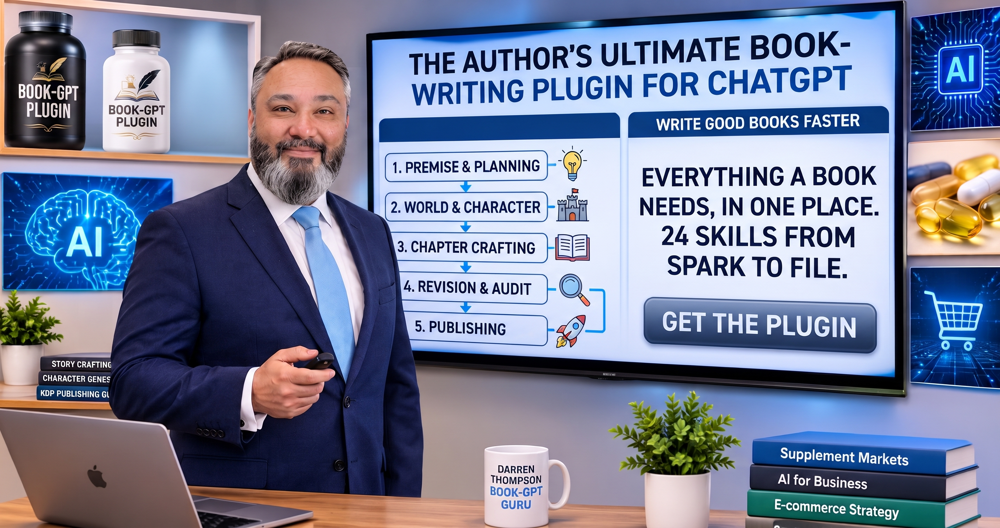

# ChatGPT-author-skills

**Free for the next 12 months.** Try all 24 skills without a fee and help us improve the plugin for version 2.0. [Download and install it](../../releases).

---

## Why this exists

[Story Skills](https://github.com/danjdewhurst/story-skills) by Daniel Dewhurst is an excellent set of 24 skills for writing fiction, built for Claude.

**ChatGPT-author-skills** brings the best of those 24 skills to ChatGPT. Every skill has been rewritten to work in ChatGPT and packaged as a single plugin, so you install it once and have the whole toolkit ready in any chat.

> Using Claude? Head to Dan's original [Story Skills](https://github.com/danjdewhurst/story-skills) repository.

---

## Installation

1. Download the latest plugin archive (.zip) from the [Releases](../../releases) page of this repository.
2. In ChatGPT, open **Plugins** from the left sidebar, or go to [chatgpt.com/plugins](https://chatgpt.com/plugins).
3. Click **Add** in the top right corner, then choose **Upload plugin archive**.
4. In the **New Plugin** window, drag and drop the .zip file, or click **click to upload** and select it.
5. Click **Add plugin**.
6. The plugin will then appear under **Installed** on the Plugins page.

ChatGPT accepts .zip, .tar.gz and .tgz archives up to 780 MB.

---

## The 24 skills

### 1. Starting out

| Skill | What it does |
| --- | --- |
| **premise-workshop** | Turns a spark of an idea into a premise strong enough to carry a whole book, with what-ifs, loglines and a controlling idea. |
| **story-init** | Sets up a new story project: the story bible, character and world files, plot structure, continuity tracking and chapter tracker. |
| **research** | Investigates the real-world facts your story depends on and keeps sourced notes, linked to the chapters that use them. |

### 2. Building the story

| Skill | What it does |
| --- | --- |
| **character-management** | Creates and maintains detailed character profiles, cross-referenced with the rest of the story. |
| **worldbuilding** | Builds and tracks locations, systems, factions, artefacts and a glossary of invented words. |
| **plot-structure** | Plans story arcs, plot points, setups and payoffs, and the timeline of events. |
| **theme-craft** | Makes theme work as a mechanism, not decoration: the controlling idea, character arcs and the antagonist as the opposing argument. |
| **genre-craft** | Applies the rules each genre expects, such as fair play clues in mysteries or the ticking clock in thrillers. |

### 3. Writing

| Skill | What it does |
| --- | --- |
| **chapter-writing** | Writes chapters outline first: a beat-by-beat plan for your approval, then the full prose, keeping continuity up to date. |
| **discovery-drafting** | For writers who prefer to write first and plan later: draft from a one-paragraph kernel, then fold each chapter back into the story bible. |
| **scene-craft** | Plans and checks individual scenes: goals, conflict, escalation and dialogue subtext. |
| **voice-style** | Records the book's voice and conventions in a style sheet, then keeps the writing consistent with it. |
| **verse-craft** | Writes and revises poetry and song lyrics, including verse that appears inside a story. |
| **interactive-fiction** | Plans and writes branching, choose-your-own-adventure style books. |

### 4. Revising

| Skill | What it does |
| --- | --- |
| **revision-continuity** | Revises chapters without breaking continuity, with continuity audits and checks before you draft the next chapter. |
| **series-continuity** | Plans and keeps track of sequels, prequels and companion books that share the same world and characters. |
| **line-editing** | Prose-quality passes once the structure is settled: clarity, rhythm, character voices, copyedit and a read-aloud pass. |
| **reader-panel** | Runs simulated reader reads of a set of chapters and writes up their feedback. |
| **feedback-triage** | Collects real beta-reader feedback, finds where readers agree and disagree, and turns it into a revision plan. |
| **editorial-review** | Handles the work involving other people: sensitivity readers, permissions for quoted material and real-people risks. |
| **story-maintenance** | Routine housekeeping: word counts, broken links, consistency checks and progress reports. |

### 5. Getting it out there

| Skill | What it does |
| --- | --- |
| **submission** | Prepares your submission to agents and publishers: query letter, synopsis, blurb and comparable titles. |
| **publishing** | Takes the finished manuscript to readers: metadata, copyright page, ebook and print files, ready for platforms such as Amazon KDP. |
| **adaptation** | Turns the book into another form: an audiobook script, a screenplay, a comics script or a translated edition. |

---

## Quick start

---

Once the plugin is installed, start a new chat and just say what you want to do. For example:

1. *"I have an idea for a sci-fi novel. Help me turn it into a premise."*
2. *"Set up a new story project for my book."*
3. *"Create the main characters and plan the plot."*
4. *"Write chapter 1 from the outline."*
5. *"Run a continuity check on chapters 1 to 5."*
6. *"Get my manuscript ready to publish on Amazon."*

You don't need to remember the skill names. ChatGPT picks the right skill from what you ask.

---

## Built from a real book

This plugin came out of writing my own novel, ***HIM and aI***.

Partway through, I lost about two thirds of the chapters because they hadn't been stored properly. I exported all my data, then used these skills to rebuild the book's structure and piece the story back together. The continuity checker, character management and plot structure skills were the ones that saved it. Along the way they led me to rename characters, rework timelines and tighten the relationships between characters, and the book ended up better than before.

*HIM and aI* is coming soon to Amazon.

---

## Credits and licence

ChatGPT-author-skills is adapted from [Story Skills](https://github.com/danjdewhurst/story-skills) by Daniel Dewhurst, released under the MIT Licence.

Adapted for ChatGPT by **Darren Thompson**.

This project is also released under the MIT Licence. See [LICENSE](LICENSE) for details, including the original copyright notice.

---

## Contributing

Issues, suggestions and pull requests are welcome.
